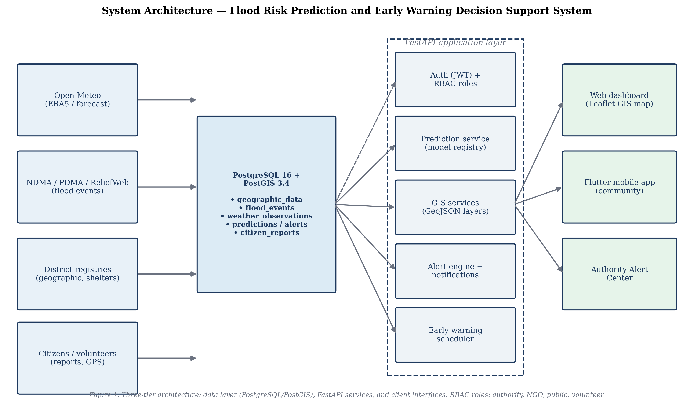

# System Architecture

The Flood Risk Prediction and Early Warning Decision Support System is a
three-tier platform: a **data layer** (PostgreSQL 16 + PostGIS 3.4), a
**service layer** (FastAPI), and **client applications** (web dashboard,
Flutter mobile app, automated scheduler). Machine learning models are
versioned in a file-based registry outside the application package so that
retraining, deployment, and the API can evolve independently.

*Figure 1 — three-tier system architecture (see
`figures/system-architecture.png`).*

## 1. Data layer

- **PostgreSQL 16 + PostGIS 3.4.** UUID primary keys; spatial columns use
  `Geometry(POINT, 4326)` consistently (see `docs/gis-module.md`, §7).
- **Schema** (`database/schema.sql`, applied via Alembic migrations
  `backend/alembic/versions/`):
  - Core: `users`, `geographic_data`, `flood_events`, `risk_assessments`,
    `predictions`, `alerts`, `emergency_contacts`, `shelters`.
  - Observations & boundaries: `weather_observations`, `district_boundaries`.
  - GIS & decision support: `infrastructure`, `vulnerability_indicators`,
    `resource_allocations`.
  - Community & notification: `citizen_reports`, `device_tokens`.
- **Seed data** (`database/seed.sql`): 12 Sindh/Punjab districts, 52
  historical flood events (incl. the 2022 Pakistan floods), demo users
  (password `demo1234`), sample infrastructure flagged `is_sample_data`.

## 2. Service layer (FastAPI, `backend/app/`)

| Service | Module | Responsibility |
|---|---|---|
| Authentication & RBAC | `core/security.py`, `api/v1/auth.py` | JWT access/refresh tokens; roles `authority` / `ngo` / `public` / `volunteer` |
| Prediction service | `services/prediction_service.py` | Model registry (`ml-models/registry.json`) + rule-based fallback; persists every assessment |
| Risk engine | `services/risk_engine.py` | Deterministic v1 weighted scorer (always available) |
| GIS | `api/v1/gis.py` | GeoJSON layers: risk, historical floods, vulnerability, infrastructure, boundaries |
| Decision support | `api/v1/decision_support.py` | Summary, year-wise trends, resource allocation |
| Alert engine | `services/alert_engine.py` | LOW → none, MEDIUM → advisory, HIGH → emergency; 6 h cooldown + escalation |
| Weather ingestion | `services/weather_ingestion.py` | Open-Meteo forecast API → `weather_observations` |
| Notifications | `services/notifications.py` | Firebase Cloud Messaging; degraded log-only mode without credentials |
| CSV/GeoJSON import | `services/importers/`, `scripts/import_csv.py` | Validated, authority-only bulk import with dry-run |
| Scheduler | `app/main.py` lifespan (APScheduler) | Early-warning cycle every `EW_CYCLE_MINUTES` (default 30) when `EW_SCHEDULER_ENABLED=true` |

The **early-warning cycle** runs: weather update → prediction engine
(default `mlp-v1`) → risk calculation → alert decision → notification, and
is detailed in `docs/early-warning-system.md`.

## 3. Machine learning (`backend/ml/` + `ml-models/`)

- **Training code** (`backend/ml/`): modular pipeline (`data_loader`,
  `preprocessing`, `feature_engineering`, `pipeline`, `evaluate`,
  `predict`), CLIs (`train.py`, `train_phase3.py`), dataset builder
  (`build_dataset.py`), weather fetcher (`fetch_weather.py`).
- **Artifacts** (`ml-models/`): `registry.json` (model versions, metrics,
  dataset SHA-256, per-row source citations) and `ml-models/models/<name>-v1/`
  (`model.joblib`, `feature_names.json`, `preprocessing.json`,
  `metrics.json`, `feature_importance.json`, `confusion_matrix.png`).
- Registered models: `rf-v1` (legacy), `randomforest-v1`, `xgboost-v1`,
  `mlp-v1` (best test F1 0.8750, ROC-AUC 0.9630), `rule-based-v1` fallback.
  The service resolves the registry via `MODEL_DIR` /
  `MODEL_REGISTRY_PATH` environment overrides, defaulting to the repo-root
  `ml-models/` directory.

## 4. Clients

- **Web dashboard prototype** (`frontend/prototype/`): Leaflet risk map,
  layer toggles, district search, decision-support charts, Authority Alert
  Center. Talks to the live API with demo fallback (`assets/api.js`).
- **Flutter mobile app** (`mobile/`): feature-first clean architecture —
  splash, auth, home, risk assessment, GIS map, alerts, emergency resources,
  offline safety guide; citizen reporting with photo upload and GPS capture.
- **External integrations**: Open-Meteo (weather, free tier), Firebase
  Cloud Messaging (push; service-account JSON required for production).

## 5. Datasets (`datasets/`)

- `datasets/raw/`: curated flood-event records (per-row source citations),
  district static attributes, cached Open-Meteo JSON.
- `datasets/processed/`: `sindh_training_2010_2024.csv` (180 district-year
  rows, 43 flood years) + `DATA_CARD.md` (sources, limitations, SHA-256).
- `datasets/templates/`: CSV/GeoJSON import templates.

## 6. Cross-cutting concerns

- **Security:** bcrypt passwords, JWT (access + refresh), role guards on
  every mutating endpoint; authority-only import, alert, and verification
  workflows.
- **Reproducibility:** dataset SHA-256 recorded in the model registry;
  migrations version the schema; tests (119 backend, 7 Flutter) run
  serially against a disposable test database.
- **Deployment:** `docker-compose.yml` (API + PostGIS), `docs/deployment.md`;
  scheduler is single-instance; FCM needs production credentials.

## Related documents

- `docs/methodology.md` — research methodology
- `docs/project-structure.md` — folder layout and conventions
- `docs/ml-pipeline.md`, `docs/ml-results.md` — model development and results
- `docs/gis-module.md`, `docs/mobile-app.md`, `docs/early-warning-system.md`
- `docs/research-paper.md`, `docs/thesis-structure.md`, `docs/contribution.md`
