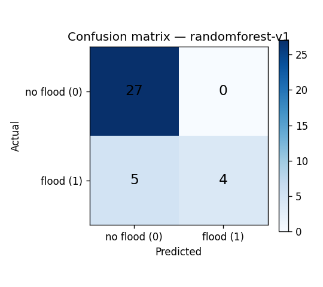
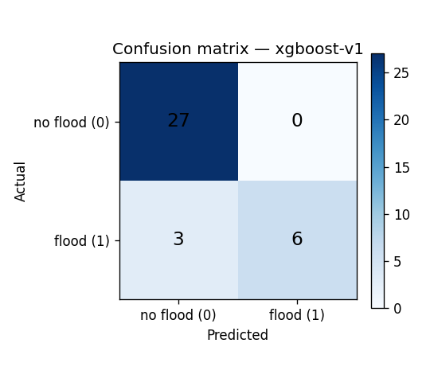
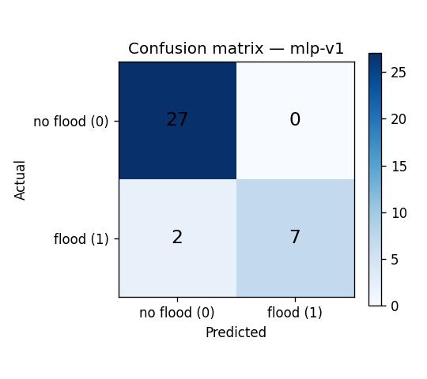

# Machine Learning Results — Phase 3: Multi-Model Flood-Risk Prediction

**Study area:** 12 districts of Sindh, Pakistan (10 Sindh + Dera Ghazi Khan and
Rajanpur, Punjab border districts affected by the same Indus riverine system)
**Study period:** 2010–2024 (15 monsoon years)
**Dataset:** `datasets/processed/sindh_training_2010_2024.csv` (180 district-year rows)
**Data card:** `datasets/processed/DATA_CARD.md`

## 1. Data and sources

| Data | Source |
|---|---|
| 43 verified district-level flood events (2010–2022) | NDMA situation reports, PDMA Sindh Flood Impact Report 2022, WHO worst-affected district lists, Pakistan Met Department records, Dawn/ReliefWeb/OCHA/IFRC situation reports — each row carries its own citation in `datasets/raw/sindh_flood_events_2010_2024.csv` |
| Daily weather 2010-01-01–2024-12-31 (precipitation, temperature, humidity) | ERA5 reanalysis via the Open-Meteo archive API; raw JSON cached in `datasets/raw/weather/<district>.json` |
| Elevation, river distance, slope, population density | Project `geographic_data` table (snapshot: `datasets/raw/district_static.csv`) |

The dataset was built by `backend/ml/build_dataset.py` (reproducible).
Dataset SHA-256: `4b478ea58d6af1f91dd65540bc32cb3e770badc428313c779d76b2700418fb62`.

### 1.1 Grain: district-year

Floods in Sindh are monsoon-season phenomena, so the analytical unit is the
monsoon year: one row per district per year (12 × 15 = 180 rows), with
monsoon-season (Jun–Sep) weather aggregates. Alternatives (one row per
district-event window) would need exact event-day weather for every historical
flood — unavailable for most rows — and would leave no honest negative class.
The district-year design gives a real negative class: 137 district-years with
no documented flood (76.1%) vs 43 flood years (23.9%).

### 1.2 Features

Ten base features: `rainfall_mm` (monsoon total), `temperature_c` (monsoon
mean), `humidity_pct` (monsoon mean), `elevation_m`, `river_distance_km`,
`slope_deg`, `population_density`, `prev_flood_events` (strictly earlier
years), `last_severity` (strictly earlier years), and `vulnerability_index` —
a documented provisional composite:

```
vulnerability_index = 0.5·minmax(log1p(population_density))
                    + 0.3·minmax(total verified events 2010–2024)
                    + 0.2·minmax(1/(1+river_distance_km))
```

Four engineered features are added at training time: `rain_intensity`
(rainfall × humidity), `lowland_river` (elevation × river proximity),
`exposure_index` (log-density × flood history), `flood_history_score`.
Label: `flooded` = 1 if ≥1 verified event in the district-year, else 0.

## 2. Experimental design

- **Split:** stratified 80/20 train/test (144/36 rows), `random_state=42`.
- **Validation:** 5-fold stratified cross-validation on the training set,
  scoring F1 (the positive class is the minority).
- **Preprocessing:** median imputation, IQR outlier capping, StandardScaler —
  parameters fitted on training data only and persisted per model.
- **Models:**
  - **randomforest-v1** — Random Forest, 300 trees, `class_weight=balanced`,
    no depth limit.
  - **xgboost-v1** — XGBoost, 300 rounds, max_depth=6, lr=0.05,
    subsample=0.9, colsample_bytree=0.9.
  - **mlp-v1** — MLP, hidden layers (64, 32), max_iter=800.
- **Feature importance:** built-in (Gini/gain) for Random Forest and XGBoost;
  permutation importance (10 repeats, F1 scoring, held-out test set) for the MLP.
- **Reproduce:** `backend/.venv/bin/python backend/ml/train_phase3.py`

## 3. Results

### 3.1 Comparison (held-out test set, n=36)

| Model | Accuracy | Precision | Recall | F1 | ROC-AUC | CV F1 (mean ± std) |
|---|---|---|---|---|---|---|
| randomforest-v1 | 0.8611 | 1.0000 | 0.4444 | 0.6154 | 0.9547 | 0.6147 ± 0.2073 |
| xgboost-v1 | 0.9167 | 1.0000 | 0.6667 | 0.8000 | 0.9465 | 0.6974 ± 0.0935 |
| mlp-v1 | 0.9444 | 1.0000 | 0.7778 | 0.8750 | 0.9630 | 0.8028 ± 0.1110 |

### 3.2 Confusion matrices

Rows = actual, columns = predicted (`[no-flood, flood]`).

**randomforest-v1** — `[[27, 0], [5, 4]]`


**xgboost-v1** — `[[27, 0], [3, 6]]`


**mlp-v1** — `[[27, 0], [2, 7]]`


### 3.3 Reading the results

1. **No false alarms, some missed events.** All three models achieve perfect
   precision (no false positives) on the test set but miss 2–5 of the 9 flood
   years. The misses are consistent with the data's limits: monsoon-season
   totals smooth over the short, intense downpours that drive urban flooding
   (e.g. Karachi 2020), and moderate events are under-reported in the sources.
2. **Ranking is stable across metrics.** mlp-v1 ≥ xgboost-v1 ≥ randomforest-v1
   on F1, recall, accuracy and CV F1. ROC-AUC is high for all three (>0.94),
   showing good ranking ability even where the 0.5 decision threshold is
   conservative.
3. **Honest uncertainty.** CV F1 standard deviations (0.09–0.21) reflect the
   small sample (144 training rows, 34 positives): fold composition changes
   results materially. These are reported, not hidden.

### 3.4 Feature importance

Top features per model (normalised, method noted):

- **randomforest-v1** (built-in): `rainfall_mm` 0.20, `rain_intensity` 0.17,
  `temperature_c` 0.14, `exposure_index` 0.09 — weather-driven.
- **xgboost-v1** (built-in): `flood_history_score` 0.20, `prev_flood_events`
  0.13, `rainfall_mm` 0.11, `population_density` 0.08 — history-driven: past
  floods are the strongest predictor of future floods, consistent with
  disaster-management experience in the Indus basin.
- **mlp-v1** (permutation): `rainfall_mm` 0.27, `rain_intensity` 0.17,
  `temperature_c` 0.13, `vulnerability_index` 0.09 — rainfall-dominated, with
  the vulnerability composite contributing measurably.

The disagreement between models is itself informative: tree ensembles split
on history while the network leans on rainfall. An operational system should
not rely on a single model family.

## 4. Prediction explanations

The API returns `feature_contributions` (top 5) alongside every ML prediction.
Method: contribution = normalised feature importance × |z-score| of the
(preprocessed, engineered) input value against the training distribution,
re-normalised to sum to 1. It answers "which features pushed *this*
prediction away from the average input?" — a descriptive, not causal, claim.
The existing `main_factors` (rule-based factor labels) are preserved.

Example (xgboost-v1, high-rainfall input): `rainfall_mm` 0.30,
`rain_intensity` 0.21, `slope_deg` 0.10, `vulnerability_index` 0.06,
`flood_history_score` 0.05.

## 5. API integration

Model aliases served by `POST /api/v1/risk/predict?model=<name>`:

| Alias | Canonical model | Registry version |
|---|---|---|
| `randomforest` | `randomforest-v1` | `randomforest-v1` |
| `xgboost` | `xgboost-v1` | `xgboost-v1` |
| `mlp` | `mlp-v1` | `mlp-v1` |
| `rf-v1` | (legacy, unchanged) | `rf-v1` |
| `rule-based-v1` | deterministic engine | `v1.0.0-rule-based` |

Unknown model names return HTTP 200 with an explanatory note and a
rule-based fallback, as before. The legacy `rf-v1` (9 features, trained on the
old live-DB sample) is preserved untouched for backward compatibility.

## 6. Disaster-management interpretation

- The models reproduce the two dominant signals disaster managers already
  use: **monsoon rainfall intensity** and **flood history** — with history
  carrying the most weight in the best tree model, supporting the practice of
  prioritising districts with repeated past inundation.
- Perfect precision / imperfect recall means the system as configured is a
  **conservative early-warning aid**: when it flags a district-year, the flag
  is trustworthy; but absence of a flag is not absence of risk. Operational
  use must keep human review for borderline monsoon outlooks.
- The vulnerability composite contributes (MLP: 0.09) but is provisional —
  it must not replace measured socioeconomic vulnerability data.

## 7. Limitations and threats to validity

1. **Small sample:** 180 rows / 43 positives; confidence bands are wide.
2. **Reporting bias:** the negative class is "no documented flood", and
   positives skew toward catastrophic events.
3. **ERA5 reanalysis**, not station observations; extremes are smoothed.
4. **Static population density** across 15 years ignores urbanisation.
5. **Temporal leakage risk is managed but not eliminated:** `prev_flood_events`
   uses strictly earlier years; however the stratified random split mixes
   years, so a district-year in the test set can share a district's later
   history with the training set. A temporal holdout (train ≤2019, test
   2020–2024) is recommended future work.
6. **Severity labels** are ordinal and source-dependent, not calibrated.
7. **The vulnerability composite** uses reasoned, not fitted or validated,
   weights.
